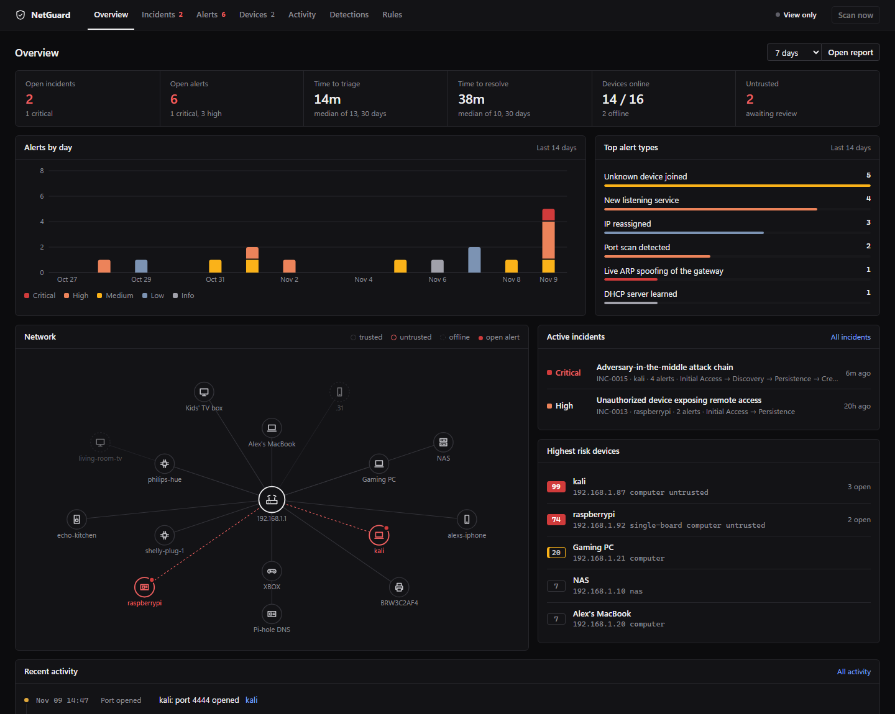
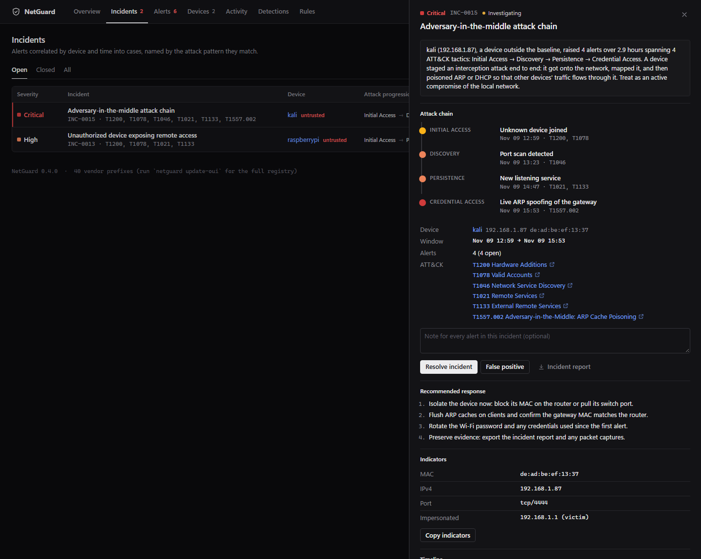
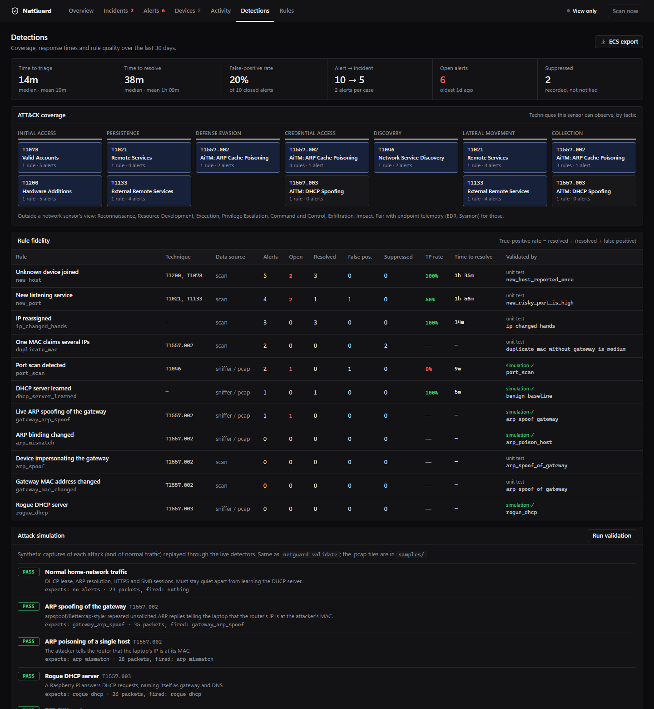
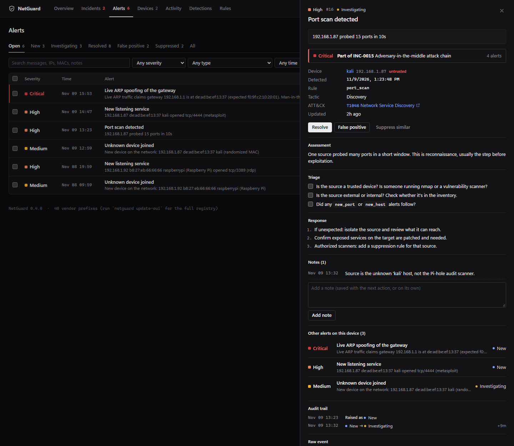
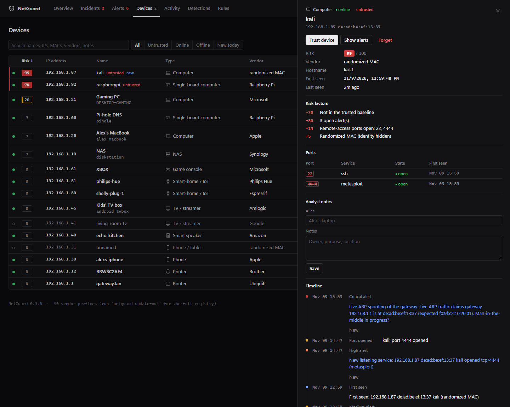

# NetGuard

**A network intrusion detection system and SOC console for small networks**,
covering detection, correlation, triage, forensics and reporting, written in
standard-library Python.

NetGuard learns what a network normally looks like, flags the changes that
signal an intruder or a man-in-the-middle, groups related alerts into
incidents with an ATT&CK-mapped attack chain, and measures how quickly and how
accurately those alerts are handled. Every detection is proven by a replayable
attack simulation that runs in CI.



*The demo network (`netguard demo`). An attacker at 192.168.1.87 joined, scanned the
network, opened a listener on tcp/4444 and is ARP-spoofing the router. Four alerts,
correlated into one critical incident.*

---

## Try it in 60 seconds

Requires Python 3.11+. No dependencies, no install step.

**Windows:** double-click **`NetGuard.bat`** and pick from the menu.
**macOS / Linux:** `./netguard.sh`

Or from a terminal in this folder:

```bash
python -m netguard demo                              # dashboard on a fictional network (view-only)
python -m netguard serve --open                      # monitor your own network (first scan = baseline)
python -m netguard stop                              # stop it (or click Stop in the dashboard)
python -m netguard validate                          # replay 7 attack simulations through the detectors
python -m netguard pcap samples/mitm_kill_chain.pcap # forensic analysis of a packet capture
```

If port 8000 is busy, NetGuard picks the next free port and prints the address;
if NetGuard is already monitoring there, `serve` just opens it. `pip install -e .`
adds a shorter `netguard` command.

## What this project demonstrates

| SOC / security skill | Where it lives |
|---|---|
| **Detection engineering** with MITRE ATT&CK mapping, severity rationale, documented blind spots and tuning | [`detect.py`](netguard/detect.py), [`docs/DETECTIONS.md`](docs/DETECTIONS.md) |
| **Detection validation**: attack simulations that must fire, benign traffic that must not, and a documented gap, enforced in CI | [`simulate.py`](netguard/simulate.py), [`samples/`](samples/), [CI](.github/workflows/tests.yml) |
| **Alert triage** workflow (New → Investigating → Resolved / False positive) with notes and an audit trail | Alerts page, [`store.py`](netguard/store.py) |
| **Incident correlation**: alerts grouped by device and time, matched to attack patterns, escalated when multi-stage | [`correlate.py`](netguard/correlate.py), Incidents page |
| **SOC metrics**: MTTA, MTTR, false-positive rate, alert-to-incident compression, per-rule true-positive rate | [`metrics.py`](netguard/metrics.py), Detections page |
| **Network forensics**: pcap/pcapng parsing from scratch, detections replayed offline, evidence by frame number | [`pcap.py`](netguard/pcap.py) |
| **SIEM integration**: Elastic Common Schema, CEF (Splunk / QRadar / ArcSight), syslog | [`siem.py`](netguard/siem.py) |
| **Incident reporting**: auto-drafted reports, plus a full written case study | [`incidents.py`](netguard/incidents.py), [case study](docs/case-study-INC-0015.md) |
| **Playbooks**: triage checklists and response steps per alert type | [`playbooks.py`](netguard/playbooks.py) |
| **Secure design** of the tool itself: CSRF, DNS rebinding, CSP, injection-safe exports | [`web/server.py`](netguard/web/server.py) |

## Detections

| Alert | Severity | ATT&CK | How | Validated by |
|---|---|---|---|---|
| `gateway_arp_spoof` | CRITICAL | T1557.002 | live ARP / pcap | simulation |
| `rogue_dhcp` | CRITICAL | T1557.003 | live DHCP / pcap | simulation |
| `gateway_mac_changed` | CRITICAL | T1557.002 | scan | unit test |
| `arp_spoof` | HIGH | T1557.002 | scan | unit test |
| `port_scan` | HIGH | T1046 | live TCP / pcap | simulation |
| `new_port` | HIGH / MEDIUM | T1021, T1133 | scan | unit test |
| `arp_mismatch` | MEDIUM | T1557.002 | live ARP / pcap | simulation |
| `new_host` | MEDIUM | T1200, T1078 | scan | unit test |
| `duplicate_mac` | MEDIUM | T1557.002 | scan | unit test |
| `ip_changed_hands` | LOW | (context) | scan | unit test |

Each rule's logic, false-positive sources, blind spots and tuning are written up
in **[docs/DETECTIONS.md](docs/DETECTIONS.md)**. Scan checks run every interval
with no special privileges; live checks (`--sniff`, scapy) catch attacks within
seconds; the same live detectors run over packet captures with no
dependencies at all.

## From alerts to incidents



Four alerts on one device in three hours are one decision, not four. The
correlation engine ([`correlate.py`](netguard/correlate.py)):

1. attributes each alert to a device (a port scan's source IP is resolved to its MAC through the inventory);
2. splits a device's alerts into clusters at gaps longer than 24 hours;
3. promotes a cluster to an incident if it has a HIGH alert or two MEDIUMs, so low-level noise stays in the queue;
4. names it after the most specific matching attack pattern (*Adversary-in-the-middle attack
   chain*, *Reconnaissance followed by service exposure*, *Unauthorized device exposing remote
   access*, ...), and escalates its severity when it spans three or more ATT&CK tactics.

The incident view shows the kill chain in the order the attacker reached it,
the indicators (keeping the *impersonated* gateway IP out of the IOC list,
since it's the victim), pattern-specific containment steps, and a one-click
**incident report** in Markdown. Actions on an incident apply to its alerts,
and closing an incident never overwrites an alert an analyst already closed as
a false positive.

> **Case study:** [docs/case-study-INC-0015.md](docs/case-study-INC-0015.md) walks
> through this incident as a written IR report: timeline by frame number,
> evidence, scope, indicators, response, and the detection gap the analysis
> uncovered.

## Detection engineering



The **Detections** page is the tuning view:

- **Response metrics** from the alert audit trail: median and mean time to triage (MTTA) and to
  resolve (MTTR), false-positive rate, and how many alerts correlation folded into each case.
- **ATT&CK coverage**: which techniques the sensor can observe, by tactic, and an explicit list of
  tactics a network sensor *can't* see (pair it with EDR / Sysmon for those).
- **Rule fidelity**: per rule, volume, outcomes and true-positive rate (resolved ÷ (resolved + false
  positive)). In the demo, `port_scan` sits at 0% because the Pi-hole's weekly audit scan was its only
  closed alert, which is exactly why a suppression rule exists for it.
- **Attack simulation**: results of replaying every scenario, live.

### Attack simulation and validation

```text
$ netguard validate
Detection validation: 7 scenarios replayed through the live detectors

  RESULT  SCENARIO                    ATT&CK     EXPECTATION
  PASS    benign_baseline             -          no alerts (false-positive check)
  PASS    arp_spoof_gateway           T1557.002  fires gateway_arp_spoof
  PASS    arp_poison_host             T1557.002  fires arp_mismatch
  PASS    rogue_dhcp                  T1557.003  fires rogue_dhcp
  PASS    port_scan                   T1046      fires port_scan
  PASS    slow_scan_below_threshold   T1046      silent: port_scan (known gap)
  PASS    mitm_kill_chain             T1557.002  fires gateway_arp_spoof, port_scan

7/7 passed
```

[`simulate.py`](netguard/simulate.py) builds byte-accurate Ethernet/ARP/IPv4/TCP/UDP/DHCP frames
with correct checksums (cross-checked against scapy) and writes them as `.pcap` files you can open in
Wireshark ([`samples/`](samples/)). Each scenario declares what must fire and what must not. CI fails
if a detection regresses or starts firing on benign traffic.

## Packet-capture forensics

```text
$ netguard pcap samples/mitm_kill_chain.pcap
Capture    mitm_kill_chain.pcap
Packets    162 over 208.0s  (2026-01-15T14:00:00+00:00 → 2026-01-15T14:03:28+00:00)
Protocols  tcp 70 · tcp_syn 65 · arp 23 · udp 2 · dhcp 2
Gateway    192.168.1.1 is-at f0:9f:c2:10:20:01  (from DHCP router option)
DHCP       server 192.168.1.1 (f0:9f:c2:10:20:01) router 192.168.1.1 dns 192.168.1.1  first frame 2

Hosts (5)
  MAC                VENDOR           FRAMES  FIRST   IPv4
  a4:83:e7:2b:11:5c  Apple                43  #1      192.168.1.20
  f0:9f:c2:10:20:01  Ubiquiti              9  #2      192.168.1.1  <- CLAIMS 192.168.1.1 (also de:ad:be:ef:13:37)
  ...
  de:ad:be:ef:13:37  randomized MAC       77  #24     192.168.1.1, 192.168.1.87  <- CLAIMS 192.168.1.1 (also f0:9f:c2:10:20:01)

Alerts (3)
  2026-01-15T14:00:00+00:00 [INFO    ] dhcp_server_learned  Trusting DHCP server 192.168.1.1 (f0:9f:c2:10:20:01)  [frame 2]
  2026-01-15T14:01:30+00:00 [HIGH    ] port_scan          192.168.1.87 probed 15 ports in 10s  [frame 56]
  2026-01-15T14:03:00+00:00 [CRITICAL] gateway_arp_spoof  Live ARP traffic claims gateway 192.168.1.1 is at de:ad:be:ef:13:37 ...  [frame 148]
```

[`pcap.py`](netguard/pcap.py) reads libpcap (µs/ns, either byte order) and pcapng, decodes Ethernet
(with 802.1Q tags) and Linux cooked captures, and feeds the **same detectors the live sniffer uses**
through one shared `dispatch()`, so offline and live results cannot drift apart. Alerts are stamped with
packet time and frame number. The gateway is learned from the capture's DHCP traffic, so no
configuration is needed. `--import` puts the alerts in the dashboard; `--json` is for scripts.

## SIEM integration

Alerts can be shipped as **ECS** (Elastic, OpenSearch), **CEF** (Splunk, QRadar, ArcSight, Sentinel) or
NetGuard JSON, both carrying the ATT&CK technique:

```toml
[alerts]
log = "alerts.ndjson"
log_format = "ecs"           # json | ecs | cef

[[notify]]
type = "syslog"              # RFC 5424 over UDP
host = "10.0.0.5"
format = "cef"
```

```text
CEF:0|NetGuard|NetGuard|0.4.0|new_port|New listening service|8|rt=1794192867000 src=192.168.1.92
  smac=b8:27:eb:66:66:66 dpt=3389 proto=TCP msg=... cat=Persistence cs1Label=mitreTechnique cs1=T1021,T1133
```

History can be exported with `netguard export --format ecs -o alerts.ndjson`. Example hunts:

```text
Elastic (KQL):  event.module : "netguard" and threat.technique.subtechnique.id : "T1557.002"
Splunk (SPL):   sourcetype=cef "CEF:0|NetGuard" | stats count by cs1, src | sort -count
```

## The dashboard

| Page | What it's for |
|---|---|
| **Overview** | Open incidents, response-time KPIs, alerts over time, network map, riskiest devices, recent activity |
| **Incidents** | Correlated cases with kill chain, indicators, response steps, bulk triage and report export |
| **Alerts** | Triage queue with filters, bulk actions, CSV/JSON export; each alert has its playbook, notes, audit trail and parent incident |
| **Devices** | Asset inventory with an explained **risk score**, port history, analyst alias and notes, device timeline |
| **Activity** | Every arrival, departure, IP change and port change |
| **Detections** | Response metrics, ATT&CK coverage, rule fidelity, live attack-simulation results |
| **Rules** | Suppression rules with reason, hit count and last hit; suppressed alerts are still stored for audit |

<table><tr>
<td></td>
<td></td>
</tr></table>

## Dashboard security

A security tool's own UI shouldn't be the weak spot:

- Binds to `127.0.0.1` by default and refuses other addresses unless a token is set.
- A Host-header allow-list blocks **DNS-rebinding** attacks from malicious websites.
- State-changing requests require a custom header that cross-site forms can't send (**CSRF**).
- A strict **Content-Security-Policy**; the UI only uses `textContent`. Hostnames come from reverse
  DNS, which an attacker controls, so they are treated as hostile everywhere: HTML report, Markdown
  incident report, CEF output.
- Static files are served from a whitelist (no path traversal); the token is compared in constant time.
- Capped-size JSON bodies; CSV exports neutralize **formula injection** (`=cmd|...`).

All of this is covered by end-to-end tests in [`tests/test_web.py`](tests/test_web.py).

## How it works

```
                 ┌── discovery (ARP sweep) ──┐
 live network ───┼── portscan (TCP connect) ─┼──► detect ──► notifier ──► SQLite ──► correlate ──► incidents
                 └── sniffer (scapy) ─┐      │    (rules +    (dedup,      (alerts,    (cases,      metrics
                                      ├──► dispatch  watchers)  suppress)   audit)      ATT&CK)      reports
 .pcap / .pcapng ── pcap (stdlib) ────┘      │                     │
 simulate (attack scenarios) ────────────────┘                     └──► desktop · webhook · email · syslog · ECS/CEF log
```

1. **Discovery.** An in-process ARP sweep needs no admin rights. On Windows `iphlpapi!SendARP`
   resolves each address; elsewhere a one-byte UDP poke triggers ARP and the OS cache is read.
2. **Identity is the MAC, not the IP.** IPs move on DHCP networks; a MAC changing for a fixed IP, or
   one MAC holding several IPs, is the real signal.
3. **Baseline, then diff.** Detection rules are pure functions over a SQLite store, so every rule is
   unit-tested without a network.
4. **One detection path.** Live packets (scapy), capture files (stdlib parser) and simulations all
   decode to the same `ArpClaim` / `TcpSyn` / `DhcpReply` events and go through one `dispatch()`.
5. **Incidents are derived, not stored.** They are recomputed from the alert table, so they can never
   drift out of sync with it.

## Command line

```bash
netguard serve --open             # dashboard + continuous monitoring (first scan = baseline)
netguard serve --sniff            # ... plus live ARP / DHCP / port-scan detection (admin + scapy)
netguard baseline                 # (re)learn the current network as trusted
netguard scan | watch -i 120      # one check / check every 2 minutes in the terminal
netguard incidents [--all]        # correlated incidents; --show INC-0015 prints the report
netguard alerts --min HIGH --open # open high & critical alerts
netguard pcap FILE [--import]     # run the detections over a capture
netguard simulate -o samples/     # write the attack-simulation captures
netguard validate [-v]            # replay them; non-zero exit if any detection misses
netguard export --format ecs|cef|json [-d 30] [-o FILE]
netguard report -d 30 -o month.html
netguard hosts | trust MAC | untrust MAC | forget MAC
netguard dhcp-check               # actively look for rogue DHCP servers
netguard update-oui | test-notify | demo
```

## Configuration

Copy [`netguard.example.toml`](netguard.example.toml) to `netguard.toml`. Every setting is optional;
flags override the file.

- `[scan]`: subnet, interval, port checks
- `[sniff]`: live detection, thresholds, allowed DHCP servers
- `[web]`: listen address, port, access token
- `[alerts]`: duplicate suppression window, log file and format (`json`, `ecs`, `cef`)
- `[[notify]]`: any number of destinations, each with its own `min_severity`: `desktop`, `webhook`
  (Discord, Slack, ntfy.sh, JSON), `email` (SMTP + STARTTLS, password from an env var), `syslog`

Live detection: `pip install -e ".[sniff]"` (scapy; on Windows also [Npcap](https://npcap.com)),
then run as administrator / root.

## Running it permanently

| Platform | How |
|---|---|
| Windows | `.\deploy\install-windows-task.ps1` (add `-Sniff` from an admin shell) registers a logon task |
| Linux / Raspberry Pi | [`deploy/netguard.service`](deploy/netguard.service), a hardened systemd unit with only `CAP_NET_RAW` |
| Docker (Linux) | `docker build -t netguard . && docker run -d --network host --cap-add NET_RAW --cap-add NET_ADMIN -v netguard-data:/data netguard` |

Use `netguard serve --reload` for background services, so an update to NetGuard's files restarts it.

## Project layout

```
netguard/
  detect.py       detection rules: scan checks + ArpWatcher, DhcpWatcher, PortScanDetector
  playbooks.py    ATT&CK mapping, triage/response playbooks, detection metadata
  correlate.py    alerts -> incidents: entity attribution, clustering, attack patterns
  incidents.py    incident actions and the Markdown incident report
  metrics.py      MTTA / MTTR, false-positive rate, rule fidelity, ATT&CK coverage
  pcap.py         stdlib pcap/pcapng reader, frame decoder, shared dispatch, offline analysis
  simulate.py     packet builders, attack scenarios, detection validation
  siem.py         ECS and CEF formatting
  sniffer.py      optional live capture (scapy) and active DHCP probe
  engine.py       Monitor: scan cycle, presence/port events, sniffer, loop
  store.py        SQLite (WAL): baseline, alerts + audit trail, events, suppressions
  notify.py       desktop / webhook / email / syslog / log sinks, de-duplication
  discovery.py    process-free ARP sweep;  portscan.py  TCP connect check
  fingerprint.py  device-type heuristics;  oui.py  IEEE vendor registry
  report.py       self-contained HTML report;  demo.py  fictional network
  web/            stdlib HTTP server + static dashboard (no build step, no external requests)
samples/          attack-simulation captures (open in Wireshark)
docs/             detection catalog, case study, screenshots
tests/            pytest: rules, watchers, correlation, metrics, pcap parsing, SIEM formats, web API, security
```

## Tests

```bash
pip install -e ".[dev]"
python -m pytest        # 120+ tests
netguard validate       # detection validation
```

CI runs the suite on Windows, macOS and Linux (Python 3.11 and 3.13), plus a separate detection
validation job that replays every scenario and checks the committed sample captures.

## Limitations

- Scan-based checks see changes once per interval; turn on `--sniff` for real-time ARP and DHCP detection.
- On Wi-Fi, a sniffer sees broadcast traffic and its own traffic only. That covers ARP spoofing of the
  gateway and DHCP, but not port scans or unicast poisoning aimed at *other* devices. A wired sensor on
  a mirror port, or offline pcap analysis, has no such limit.
- Low-and-slow port scans below the threshold are not detected (documented and tested as a known gap).
- Phones with private Wi-Fi addresses appear as `new_host` when they rotate MACs; they're labelled
  "randomized MAC" so this is obvious.
- IPv4 only. Device types are heuristics for readability and are never used for detection.

NetGuard only watches your own network. It doesn't attack anything, and the attack simulations
are files on disk: nothing is ever transmitted.

*`NetworkInventory.py` is the original one-file scanner NetGuard grew out of.*
